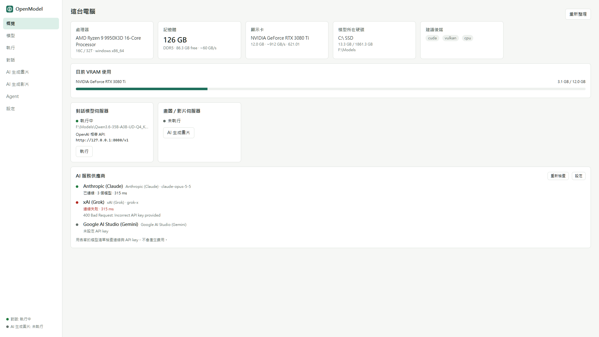
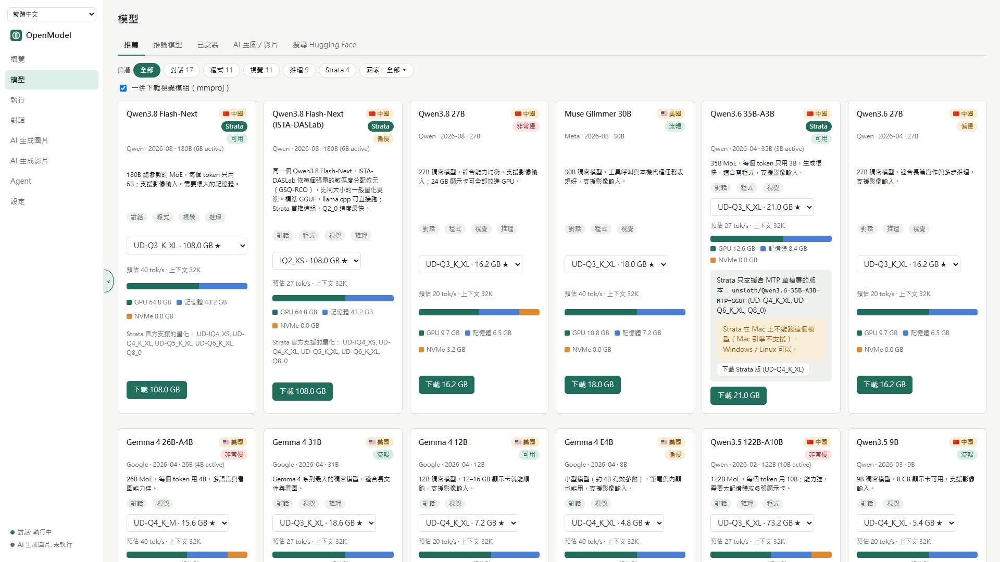
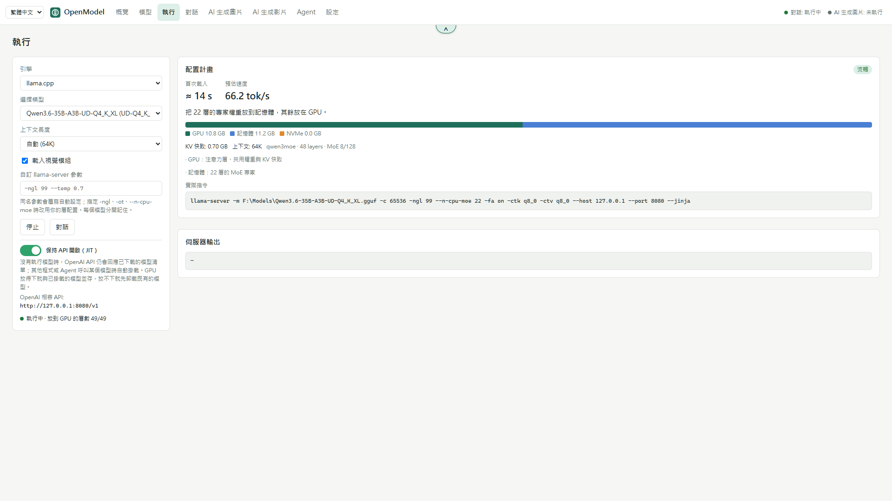
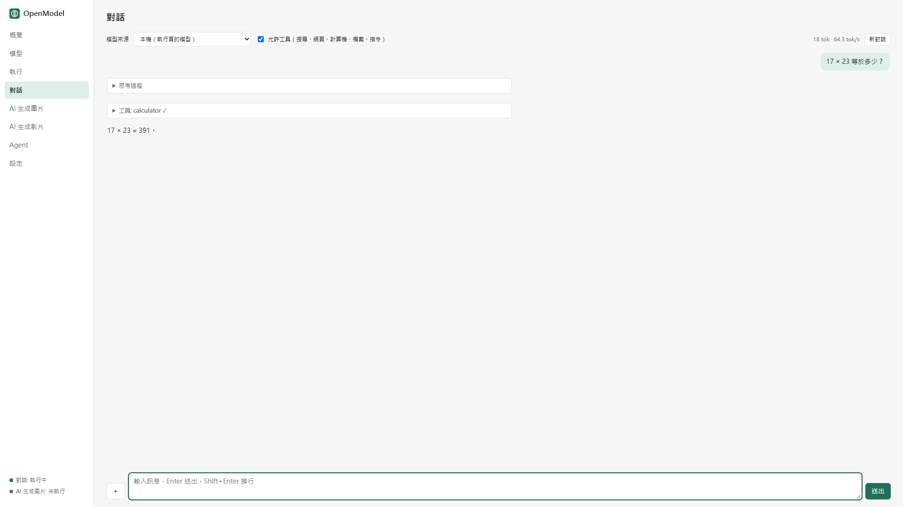
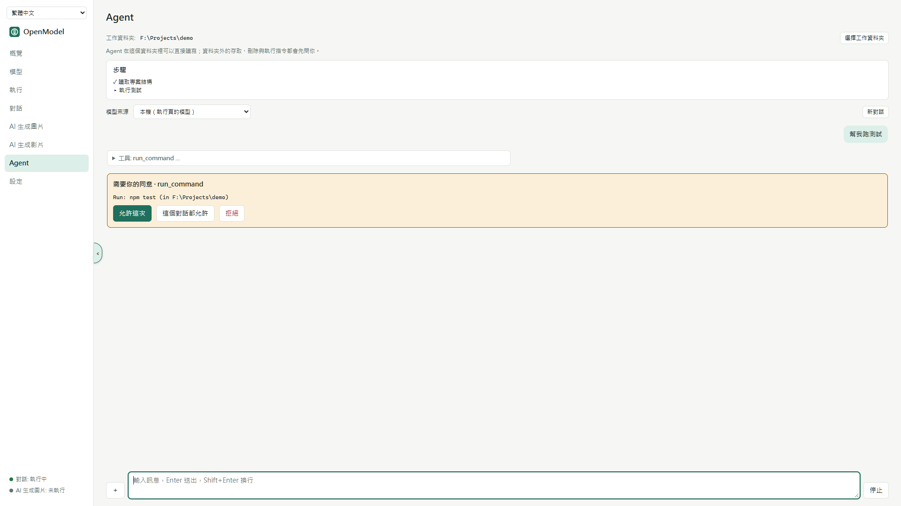
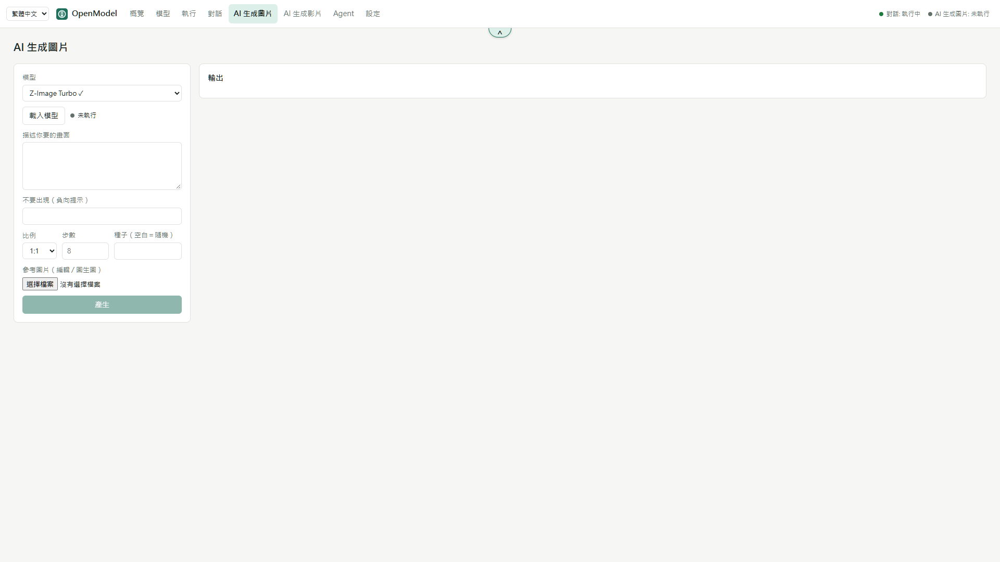
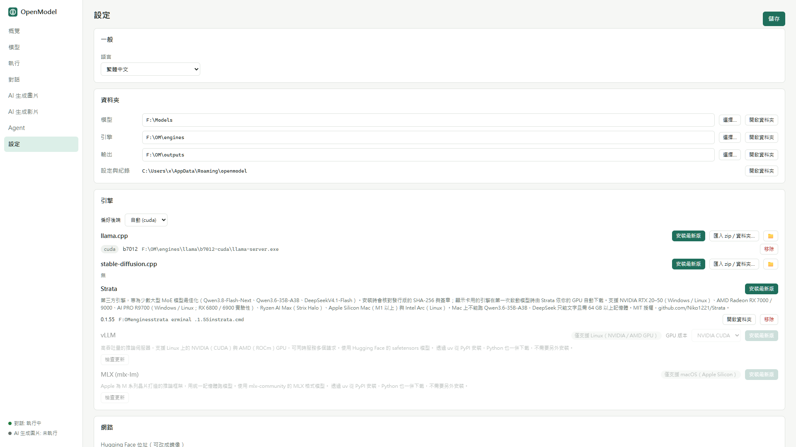

# OpenModel-Manager

[繁體中文](README.md) | **English**

[](https://github.com/mosesmoon/openmodel-manager/actions/workflows/ci.yml) [](https://github.com/mosesmoon/openmodel-manager/actions/workflows/security.yml)

An open-source, cross-platform (Windows / Linux / macOS) manager for local AI models. It detects your hardware and plans how a model splits across GPU, RAM and disk. It then installs inference engines, downloads models from Hugging Face and starts an OpenAI-compatible local server. Chat, an agent, and AI image and video generation are built in.



## Features

- **Hardware detection**: NVIDIA, AMD, Intel and Apple Silicon. Reads VRAM (including APU shared memory); RAM type, speed and channel count, which give its bandwidth; and whether the model drive is NVMe (with its PCIe generation and lanes), a SATA SSD, USB or a hard disk.
- **Placement planning**: before you download, it estimates the GPU / RAM / disk split and tok/s for every quantization. When a model doesn't fit on the GPU, it falls back in order: MoE expert offload, layer offload, then mmap spill to disk. It also picks the largest context that doesn't slow the model down.
- **Inference engines**, each downloaded and updated from inside the app:
  - [llama.cpp](https://github.com/ggml-org/llama.cpp): CUDA, Vulkan, ROCm, Metal or CPU, chosen automatically.
  - [stable-diffusion.cpp](https://github.com/leejet/stable-diffusion.cpp): image and video generation.
  - [Strata](https://github.com/Niko1221/Strata): very large MoE models such as DeepSeek; supports Mac and AMD GPUs.
  - [vLLM](https://github.com/vllm-project/vllm): Linux, with NVIDIA CUDA or AMD ROCm.
  - [MLX](https://github.com/ml-explore/mlx-lm): macOS on Apple Silicon.
- **Model catalog**:
  - Filter recommendations by capability (chat / code / vision / reasoning), by country of origin (🇺🇸 🇨🇳 🇫🇷 …), or by Strata support.
  - Search Hugging Face directly.
  - Downloads resume, and you can set your own mirror and token.
- **Crash recovery**: when a model fails to load, it works out why and retries automatically in compatibility mode.
- **Chat** with local models or an AI service provider:
  - Providers: Anthropic, OpenAI, Google AI Studio, xAI Grok, NVIDIA NIM, or any OpenAI-compatible API.
  - Tool calls, image input, and visible reasoning.
- **Agent**: reads and writes files and runs commands inside a workspace folder you choose, with a visible step list.
- **AI image and video generation**: Z-Image, FLUX.2 klein, FLUX.1 schnell, Qwen-Image, Wan2.2 and more.
- **OpenAI-compatible API**: other apps and agents (such as Hermes Agent) can use the model you start. You can set an API key (or leave it blank) and choose which network cards to open it on. With JIT on, the API lists your downloaded models even when none is running and loads the one a request asks for.
- **Web management page**: other computers and phones can open the same UI in a browser, with password sign-in and a green/red on/off switch. You also choose which network cards it opens on.
- **Layout**: the menu can sit on the left, right, top or bottom, and the half-circle button on its edge folds it away.
- **Supply-chain security**: CI scans dependencies for vulnerabilities, produces SPDX and CycloneDX SBOMs, and signs build provenance for the installers.
- **Languages**: Traditional Chinese and English, switched from the top of the menu. The zh-TW MSI opens in Chinese; the en-US MSI and the portable build open in English.

See [CHANGELOG.md](CHANGELOG.md) for what changed in each version.

## Principles

- **No telemetry**: nothing about installs, devices or usage is reported anywhere.
- **No relay or paid proxy**: the app contacts only hosts you configure. That means Hugging Face or your chosen mirror, GitHub or your chosen download prefix, and the AI service providers you add.
- **Tool approval is enforced in the backend**: the Rust backend waits for your approval before it runs a command, deletes a file, or touches a path outside the workspace. The UI cannot bypass it.
- **AMD and Intel are first-class**: Vulkan and ROCm get the same priority as CUDA.

## Download

Get builds from [Releases](../../releases).

| Platform | File | Notes |
|---|---|---|
| Windows | `*_en-US.msi` | Installer, English (installer and app) |
| Windows | `*_zh-TW.msi` | Installer, Traditional Chinese (installer and app) |
| Windows | `*_portable.zip` | Portable (English by default): unzip and run. Settings, models, engines and outputs live in `OpenModelData/` beside the program |
| Linux | `.AppImage` | Needs glibc 2.35 or newer (Ubuntu 22.04+) |
| Linux | `.flatpak` | `flatpak install --user OpenModel-Manager.flatpak` |
| Linux | `.deb` | Debian / Ubuntu |
| macOS | `.dmg` | Open it and drag the app to Applications. It is unsigned, so the first time, right-click the app and choose Open |

## Connect other apps through the OpenAI API

OpenModel-Manager serves an OpenAI-compatible API at `http://127.0.0.1:8080/v1` (the port is in Settings; the Overview page shows the address). Any tool that speaks the OpenAI API can connect, such as Hermes Agent, Open WebUI, Continue, Cline, or the `openai` SDK. When a tool asks for a custom endpoint, enter the address up to `/v1`:

```python
from openai import OpenAI

client = OpenAI(base_url="http://127.0.0.1:8080/v1", api_key="none")
r = client.chat.completions.create(
    model="local",
    messages=[{"role": "user", "content": "Hello"}],
)
print(r.choices[0].message.content)
```

To let other computers connect:

1. In Settings, tick "Allow connections from other computers".
2. Tick the network cards to open. Only connected IPv4 addresses are listed; with none ticked, every card is opened.
3. The Overview page lists every address the server can be reached on.

The model server itself listens only on `127.0.0.1`. OpenModel-Manager's API gateway accepts connections on the ticked addresses and passes them on, so cards you leave unticked can't be used to connect. Without "Allow connections from other computers", a LAN address such as `http://192.168.0.101:8080/v1` refuses the connection.

**Keep the API on (JIT)**: with this switch on (Run page):

- `GET /v1/models` lists every downloaded model even when none is running.
- A call that names a model (`model` set to a name from that list) loads it first, then answers.
- If a model is already running, the new one is loaded next to it when the GPU has room; otherwise the running model is unloaded first.

Without JIT, every call goes to the model that is running, and the API answers 503 when none is.

**Context length**: agents such as Hermes need a context of 64K or more. "Auto context at least" in Settings is 64K by default, so an automatic context (including JIT loads) is never smaller.

**API key**: set one in Settings, or press Generate. Leave it blank for no key. Once a key is set, clients must send `Authorization: Bearer <key>` (`api_key=` in the example above). llama.cpp, vLLM and Strata check the key; MLX has no authentication. Setting a key is recommended when other computers can connect.

## Web management page

Other computers and phones can open the same management UI in a browser:

1. In the desktop app, go to Settings → Web management page and set a sign-in password (at least 6 characters).
2. Turn on the switch at the top right (green is on, red is off).
3. By default only `http://127.0.0.1:8765/` on this computer is opened. To let other devices connect, tick "Let other computers open the web page", then tick the network cards to open.

A browser can't browse that computer's files, so where the window shows a file or folder picker, the web page asks you to type a path. The page uses plain HTTP, so only open it on a network you trust.

The menu can sit on the left, right, top or bottom (Settings → General), and the half-circle button on its edge folds it away. This preference is kept per device and browser.

## Screenshots

| | |
|---|---|
|  |  |
|  |  |
|  |  |

## Supply-chain security

The **Security** badge at the top shows the latest scan result (green means it passed).

- **Dependency scan**: runs on every push, every pull request and every Monday, and fails on any known vulnerability.
  - Rust: `cargo audit` against the [RustSec](https://rustsec.org/) database.
  - Frontend: `npm audit` against the npm advisory database.
  - Each run keeps the full JSON reports in its `security-report` artifact.
- **SBOM (software bill of materials)**: produced after every passing scan. It covers both the Rust and the frontend dependencies, in the two common formats:
  - SPDX: `openmodel-manager.spdx.json`
  - CycloneDX: `openmodel-manager.cdx.json`
  - Download them from the `sbom` artifact of a [Security run](https://github.com/mosesmoon/openmodel-manager/actions/workflows/security.yml); releases will also carry them as release files.
- **Build provenance**: for version tags, CI signs a GitHub attestation for every installer. It records the repository, commit and workflow run that built the file, and binds the SBOM to it. Check a download with:

  ```bash
  gh attestation verify OpenModel-Manager_0.1.0_x64_en-US.msi -R mosesmoon/openmodel-manager
  ```

Known notices: a few components Tauri uses on Linux (`glib`, the `zbus` family, `proc-macro-error`) are flagged as unmaintained or as having an unsound API. These are not vulnerabilities; the scan lists them without failing, and they will go away as Tauri updates.

## Build from source

You need:

- Rust stable (1.80+).
- Node.js 24.22.1 or newer; older releases are affected by CVE-2026-111497.
- On Linux, `libwebkit2gtk-4.1-dev` and the other packages listed in the [Tauri prerequisites](https://v2.tauri.app/start/prerequisites/).

```bash
cd app && npm ci && npm run build && cd ..   # build the frontend first (the desktop app needs app/dist)
cargo test
cargo build --release -p openmodel-cli       # CLI only

cd app
npx tauri dev                                # development mode
npx tauri build                              # installers in target/release/bundle/
```

Packaging scripts live in [`packaging/`](packaging/):

| Script | Output |
|---|---|
| `packaging/windows-portable.ps1` | Windows portable zip |
| `packaging/linux/build.sh` | AppImage, deb and Flatpak, built in an Ubuntu 22.04 container |
| `packaging/macos/build.sh` | Universal macOS DMG (run on a Mac) |

## CLI

```bash
openmodel hw                                             # hardware and recommended backend
openmodel plan --catalog qwen3.6-35b-a3b --quant UD-Q4_K_XL
openmodel hf files unsloth/gpt-oss-20b-GGUF
openmodel hf download unsloth/gpt-oss-20b-GGUF Q4_K_M
openmodel engine install                                 # picks CUDA / Vulkan / ROCm / Metal / CPU
openmodel engine install --backend vulkan
openmodel serve <path/to/model.gguf> --lan               # retries in compatibility mode on failure
```

By default, data is kept in the system's application data folder. You can change where it goes in two ways:

- Set `OPENMODEL_HOME` to the folder you want.
- Put a `portable.txt` next to the executable to switch to portable mode. Data then goes in `OpenModelData/`.

## Layout

| Path | Contents |
|---|---|
| `crates/core` | Core library: hardware, GGUF, placement planning, downloads, engines, servers, LLM streaming, tools, agent |
| `crates/cli` | The `openmodel` command-line tool |
| `app/` | Tauri 2 desktop app (React + Vite + TypeScript) |
| `packaging/` | Per-platform packaging scripts |
| `docs/STATUS.md` | Progress, plus what has and hasn't been verified (in Chinese) |

## Status

This is version 0.1.0.

- The core has unit tests.
- The desktop app builds and runs on Windows.
- The engines and models haven't been tested on every platform yet. See [docs/STATUS.md](docs/STATUS.md).

Issue reports are welcome.

## License

Apache-2.0 OR MIT, at your option. See [LICENSE-APACHE](LICENSE-APACHE) and [LICENSE-MIT](LICENSE-MIT).

Third-party assets: the artwork in the flag font `app/public/fonts/TwemojiCountryFlags.woff2` comes from [Twemoji](https://github.com/twitter/twemoji) (CC BY 4.0). The font subset was made with [country-flag-emoji-polyfill](https://github.com/talkjs/country-flag-emoji-polyfill) (MIT); see `TwemojiCountryFlags.LICENSE.txt` in the same folder. The inference engines are separate programs downloaded at runtime, each under its own license.
