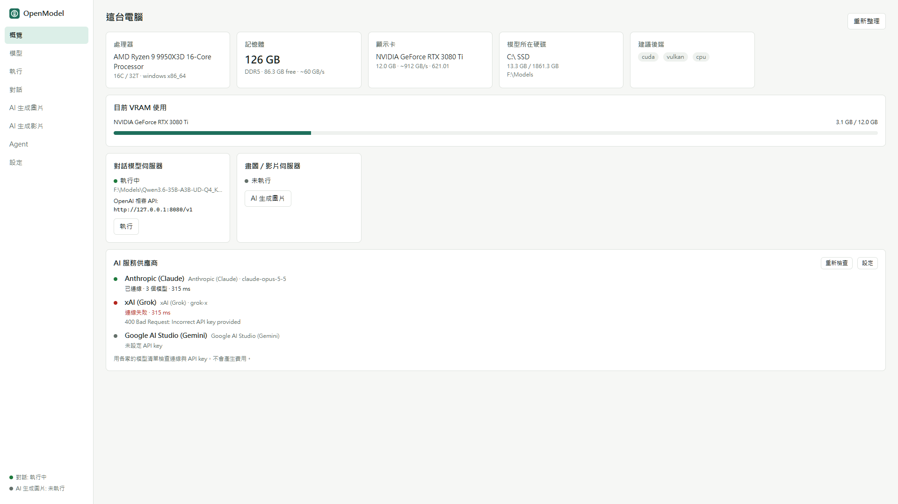
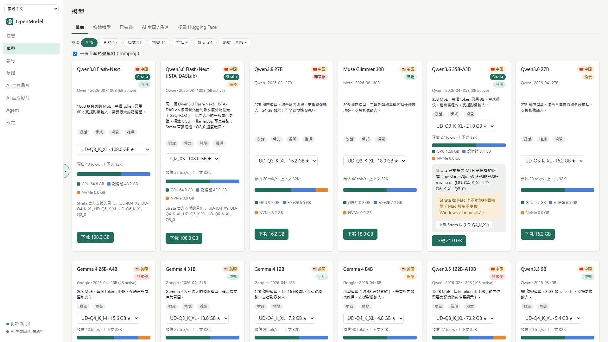
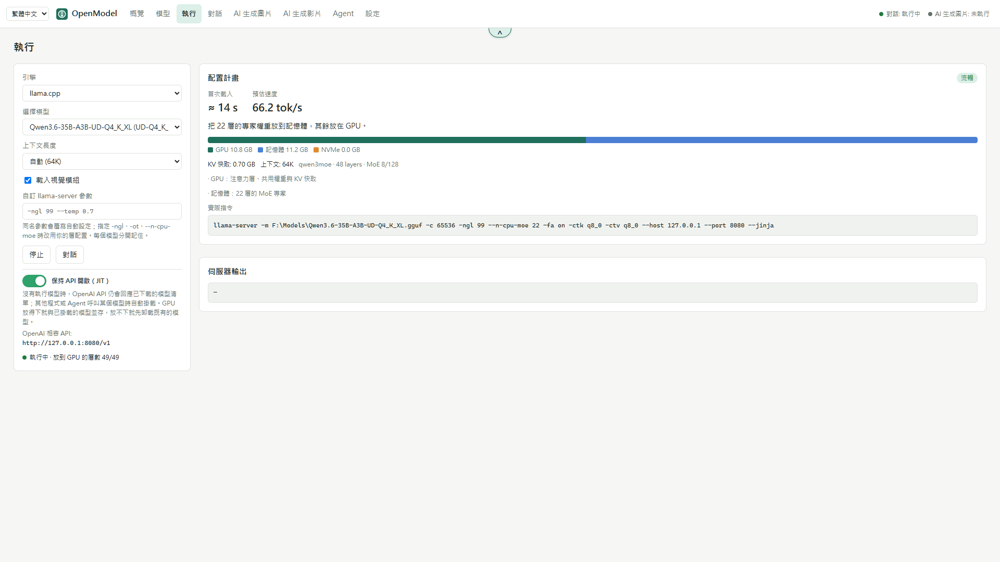
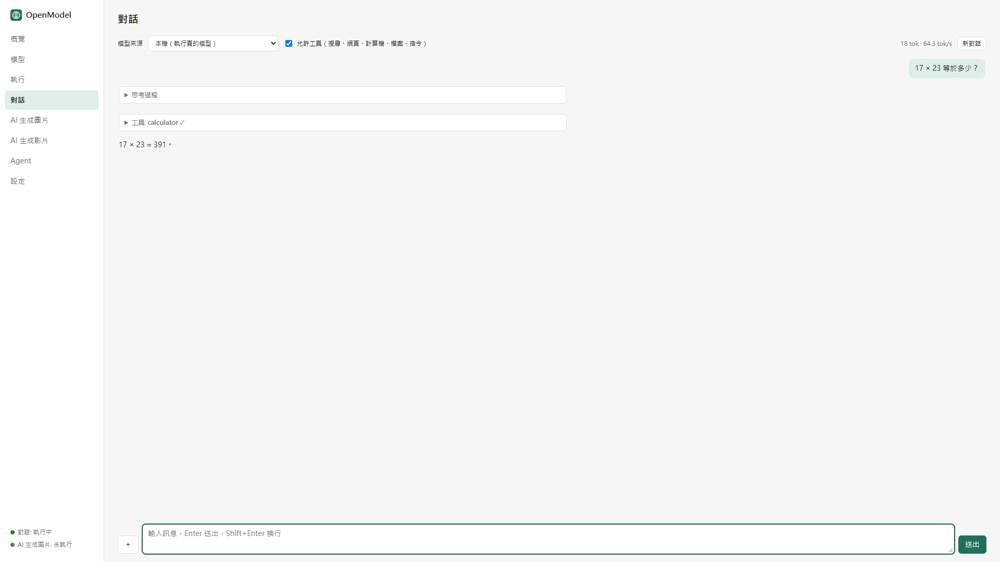
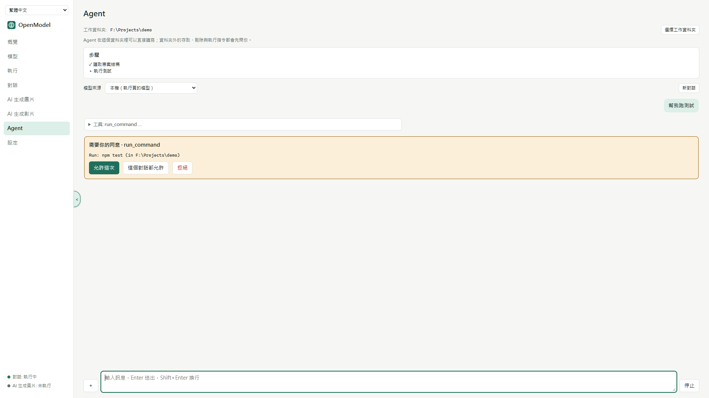
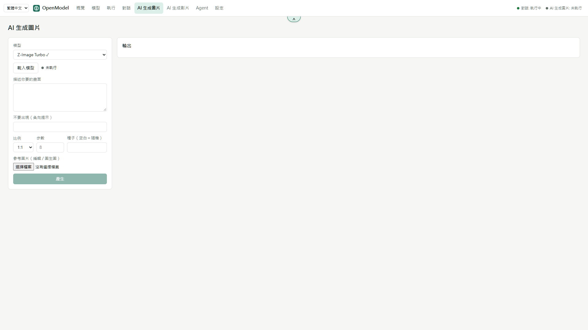
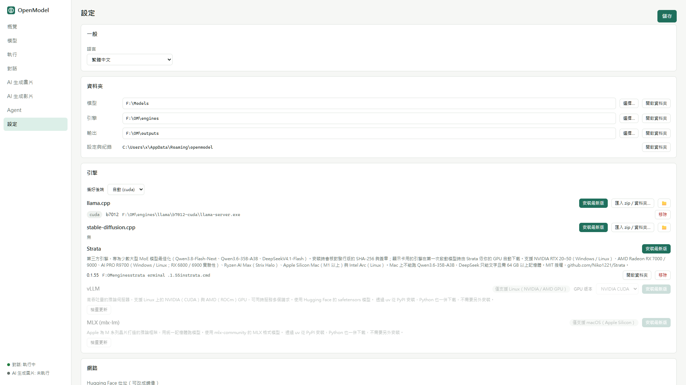

# OpenModel-Manager

**繁體中文** | [English](README.en.md)

開源、跨平台（Windows / Linux / macOS）的本機 AI 模型管理工具。它會偵測你的硬體，規劃模型要怎麼分配到 GPU、記憶體和硬碟，接著幫你安裝推論引擎、從 Hugging Face 下載模型，並啟動 OpenAI 相容的本機伺服器。程式內建對話、Agent、AI 生成圖片與 AI 生成影片。



## 功能

- **硬體偵測**：支援 NVIDIA、AMD、Intel 和 Apple Silicon，會讀取 VRAM（含 APU 共用記憶體）、RAM 類型、SSD / HDD。
- **配置規劃**：在下載前就估算每個量化版本的 GPU / RAM / 硬碟分配和預估 tok/s。放不進 GPU 時，依序改用 MoE 專家卸載、層卸載、mmap 溢出到硬碟。也會自動選最大且不降速的 context。
- **推論引擎**，都能從程式內下載與更新：
  - [llama.cpp](https://github.com/ggml-org/llama.cpp)：CUDA / Vulkan / ROCm / Metal / CPU，自動選擇。
  - [stable-diffusion.cpp](https://github.com/leejet/stable-diffusion.cpp)：生成圖片與影片。
  - [Strata](https://github.com/Niko1221/Strata)：超大 MoE 模型（例如 DeepSeek），支援 Mac 與 AMD GPU。
  - [vLLM](https://github.com/vllm-project/vllm)：Linux，NVIDIA CUDA 或 AMD ROCm。
  - [MLX](https://github.com/ml-explore/mlx-lm)：macOS Apple Silicon。
- **模型目錄**：推薦清單可依能力（chat / code / vision / reasoning）、來源國家（🇺🇸 🇨🇳 🇫🇷 …）和 Strata 支援篩選，也能直接搜尋 Hugging Face。下載可續傳，鏡像與 token 可自訂。
- **崩潰自動處理**：載入失敗時會判斷原因，並自動用相容模式重試。
- **對話**：可接本機模型或 AI 服務供應商，包括 Anthropic、OpenAI、Google AI Studio、xAI Grok、NVIDIA NIM 及任何 OpenAI 相容 API。支援工具呼叫、圖片輸入、顯示思考過程。
- **Agent**：在指定的工作資料夾內讀寫檔案、執行指令，每一步都有清單可看。
- **AI 生成圖片 / 影片**：Z-Image、FLUX.2 klein、FLUX.1 schnell、Qwen-Image、Wan2.2 等。
- **介面語言**：繁體中文（預設）與英文。

## 設計原則

- **沒有遙測**：不上報任何安裝、裝置或使用資料。
- **沒有中轉代理或付費通道**：只連你設定的主機，例如 Hugging Face 或你選的鏡像、GitHub 或你選的加速前綴，以及你自己加入的 AI 服務供應商。
- **工具審批在後端強制**：執行指令、刪除檔案、存取工作資料夾以外的路徑，一律由 Rust 後端等你同意，前端無法繞過。
- **AMD / Intel 是一等公民**：Vulkan 與 ROCm 和 CUDA 一樣優先支援。

## 下載與安裝

請到 [Releases](../../releases) 下載。

| 平台 | 檔案 | 說明 |
|---|---|---|
| Windows | `.msi` | 安裝版 |
| Windows | `*_portable.zip` | 免安裝版：解壓即可用，設定、模型、引擎、輸出都放在旁邊的 `OpenModelData/` |
| Linux | `.AppImage` | 需要 glibc 2.35 以上（Ubuntu 22.04+） |
| Linux | `.flatpak` | `flatpak install --user OpenModel-Manager.flatpak` |
| Linux | `.deb` | Debian / Ubuntu |
| macOS | `.dmg` | 打開後把程式拖到 Applications。未簽章，第一次開啟要按右鍵 → 打開 |

## 讓其他程式透過 OpenAI API 連進來

在「執行」頁啟動模型後，OpenModel-Manager 會開一個 OpenAI 相容的伺服器（預設 `http://127.0.0.1:8080/v1`，實際連接埠顯示在概覽頁）。任何支援 OpenAI API 的工具都能直接連，例如 Open WebUI、Continue、Cline、或 `openai` SDK：

```python
from openai import OpenAI

client = OpenAI(base_url="http://127.0.0.1:8080/v1", api_key="none")
r = client.chat.completions.create(
    model="local",
    messages=[{"role": "user", "content": "你好"}],
)
print(r.choices[0].message.content)
```

要讓其他電腦連進來：

1. 到「設定」勾選「允許本機以外的電腦連線」。
2. 勾選要開放的網路卡。清單只列出有連上網路的 IPv4 位址，都沒勾時會開放全部網卡。
3. 概覽頁會列出每個可連線的網址。

模型伺服器本身只聽 `127.0.0.1`，勾選的位址由 OpenModel-Manager 轉接過去，所以沒勾的網卡連不進來。

**API key**：可在「設定」填入或按「產生」，留空就是不需要 key。設定後，用戶端要帶 `Authorization: Bearer <key>`（上面範例的 `api_key=`）。llama.cpp、vLLM、Strata 都會檢查 key，MLX 沒有驗證功能。開放給其他電腦時建議設定 key。

## 截圖

| | |
|---|---|
|  |  |
|  |  |
|  |  |

## 從原始碼建置

需要 Rust stable（1.80+）與 Node.js 24.22.1 以上（較舊版本受 CVE-2026-111497 影響）。Linux 另需 `libwebkit2gtk-4.1-dev` 等套件，詳見 [Tauri 前置需求](https://v2.tauri.app/start/prerequisites/)。

```bash
cd app && npm ci && npm run build && cd ..   # 先建前端（編譯桌面程式需要 app/dist）
cargo test
cargo build --release -p openmodel-cli       # 只建 CLI

cd app
npx tauri dev                                # 開發模式
npx tauri build                              # 產生安裝檔（target/release/bundle/）
```

打包腳本在 [`packaging/`](packaging/)：

| 腳本 | 產出 |
|---|---|
| `packaging/windows-portable.ps1` | Windows 免安裝 zip |
| `packaging/linux/build.sh` | 在 Ubuntu 22.04 容器內建 AppImage、deb、Flatpak |
| `packaging/macos/build.sh` | macOS 通用版 DMG（要在 Mac 上執行） |

## CLI

```bash
openmodel hw                                             # 硬體與建議後端
openmodel plan --catalog qwen3.6-35b-a3b --quant UD-Q4_K_XL
openmodel hf files unsloth/gpt-oss-20b-GGUF
openmodel hf download unsloth/gpt-oss-20b-GGUF Q4_K_M
openmodel engine install                                 # 自動選 CUDA / Vulkan / ROCm / Metal / CPU
openmodel engine install --backend vulkan
openmodel serve <path/to/model.gguf> --lan               # 失敗時自動以相容模式重試
```

資料預設放在系統的應用程式資料夾。設定環境變數 `OPENMODEL_HOME` 可以改位置；在執行檔旁放一個 `portable.txt` 則會啟用可攜模式，資料放在 `OpenModelData/`。

## 專案結構

| 路徑 | 內容 |
|---|---|
| `crates/core` | 核心函式庫：硬體、GGUF、配置規劃、下載、引擎、伺服器、LLM 串流、工具、Agent |
| `crates/cli` | `openmodel` 命令列工具 |
| `app/` | Tauri 2 桌面程式（React + Vite + TypeScript） |
| `packaging/` | 各平台打包腳本 |
| `docs/STATUS.md` | 進度、已驗證與未驗證的項目 |

## 目前狀態

這是 0.1.0 版。核心功能都有單元測試，桌面程式能在 Windows 建置和執行。各引擎與模型還沒有在所有平台實測，詳見 [docs/STATUS.md](docs/STATUS.md)。歡迎回報問題。

## 授權

Apache-2.0 OR MIT，任選其一。見 [LICENSE-APACHE](LICENSE-APACHE)、[LICENSE-MIT](LICENSE-MIT)。

第三方素材：國旗字型 `app/public/fonts/TwemojiCountryFlags.woff2` 的圖案來自 [Twemoji](https://github.com/twitter/twemoji)（CC BY 4.0），字型子集由 [country-flag-emoji-polyfill](https://github.com/talkjs/country-flag-emoji-polyfill)（MIT）製作，詳見同目錄的 `TwemojiCountryFlags.LICENSE.txt`。推論引擎是在執行時另外下載的獨立程式，各自有自己的授權。
